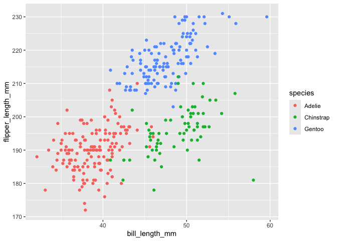

P8105 Homework 1
================
Jinghao Zhang
2026-09-26

# Problem 1

``` r
data("penguins", package = "palmerpenguins")
```

The penguins dataset shows data on penguin species, island, bill length,
bill depth, flipper length, body mass, sex, and year.

There are 344 observations and 8 variables.

The mean flipper length is 200.9152047mm.

``` r
library(tidyverse)
```

    ## ── Attaching core tidyverse packages ──────────────────────── tidyverse 2.0.0 ──
    ## ✔ dplyr     1.2.1     ✔ readr     2.2.0
    ## ✔ forcats   1.0.1     ✔ stringr   1.6.0
    ## ✔ ggplot2   4.0.3     ✔ tibble    3.3.1
    ## ✔ lubridate 1.9.5     ✔ tidyr     1.3.2
    ## ✔ purrr     1.2.2     
    ## ── Conflicts ────────────────────────────────────────── tidyverse_conflicts() ──
    ## ✖ dplyr::filter() masks stats::filter()
    ## ✖ dplyr::lag()    masks stats::lag()
    ## ℹ Use the conflicted package (<http://conflicted.r-lib.org/>) to force all conflicts to become errors

``` r
penguin_scatterplot = ggplot(
  penguins,
  aes(x = bill_length_mm, y = flipper_length_mm, color = species)) + 
  geom_point()

penguin_scatterplot
```

    ## Warning: Removed 2 rows containing missing values or values outside the scale range
    ## (`geom_point()`).

<!-- -->

``` r
ggsave("penguin_scatterplot.png", plot = penguin_scatterplot)
```

    ## Saving 7 x 5 in image

    ## Warning: Removed 2 rows containing missing values or values outside the scale range
    ## (`geom_point()`).

# Problem 2

``` r
set.seed(1234)

problem2_df = tibble(
  vec_numeric = rnorm(10),
  vec_logical = vec_numeric > 0,
  vec_char = c("a", "b", "c", "d", "e", "f", "g", "h", "i", "j"),
  vec_factor = factor(c("low", "medium", "high", "low", "medium", "high", "low", "medium", "high", "low"))
)

problem2_df
```

    ## # A tibble: 10 × 4
    ##    vec_numeric vec_logical vec_char vec_factor
    ##          <dbl> <lgl>       <chr>    <fct>     
    ##  1      -1.21  FALSE       a        low       
    ##  2       0.277 TRUE        b        medium    
    ##  3       1.08  TRUE        c        high      
    ##  4      -2.35  FALSE       d        low       
    ##  5       0.429 TRUE        e        medium    
    ##  6       0.506 TRUE        f        high      
    ##  7      -0.575 FALSE       g        low       
    ##  8      -0.547 FALSE       h        medium    
    ##  9      -0.564 FALSE       i        high      
    ## 10      -0.890 FALSE       j        low

``` r
mean(pull(problem2_df, vec_numeric))
```

    ## [1] -0.3831574

``` r
mean(pull(problem2_df, vec_logical))
```

    ## [1] 0.4

``` r
mean(pull(problem2_df, vec_char))
```

    ## Warning in mean.default(pull(problem2_df, vec_char)): argument is not numeric
    ## or logical: returning NA

    ## [1] NA

``` r
mean(pull(problem2_df, vec_factor))
```

    ## Warning in mean.default(pull(problem2_df, vec_factor)): argument is not numeric
    ## or logical: returning NA

    ## [1] NA

The mean works for the random sample and logical vector. But it does not
work for character vector and factor vector because they are not numeric
or logical variables.

``` r
as.numeric(pull(problem2_df, vec_logical))
as.numeric(pull(problem2_df, vec_char))
as.numeric(pull(problem2_df, vec_factor))
```

The logical and factor vector can be converted to numeric values.
Because in logical vector, true is treated as 1 and false is treated as
0. For factor vectors, medium is converted to 3, low to 2, and high
to 1. Character vector cannot be converted.
